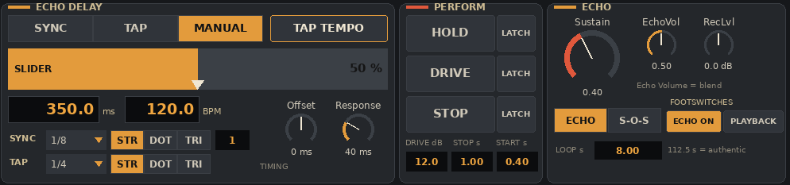

<div align="center">

# 🟥🟨🟩 ECHOLIVITY

# EP-3 TAPE ECHO

### A moving-record-head tape echo for Ableton Live 12

**WRITE THE PITCH. LOOP THE TAPE. SEND IT ROUND AGAIN.**




| 🟥 RED — PERFORM | 🟨 GOLD — ECHO & TAPE | 🟩 GREEN — FILTERS & OUTPUT |
|:---:|:---:|:---:|

*A Max for Live tape echo modelled on the Maestro Echoplex EP-3, the solid-state tape echo built from 1970 to 1991. Made for dub: throws, rides into self-oscillation, sirens and frozen loops.*

**Part of the Echolivity Classic Echo Collection** · [H&H Echo Unit](https://github.com/Echolivity/echolivity-hh) · [Dub Siren](https://github.com/Echolivity/echolivity-dub-siren) · [Fisher Spring](https://github.com/Echolivity/fisher-spring)

</div>

---

> [!IMPORTANT]
> **DEVELOPMENT BUILD · v0.1.3-dev: not yet run in Max 9 or Ableton Live 12.**
>
> The engine passes 53 automated tests, but those run the device's code outside Max. Loading in Live, compiling in Max and listening by ear are still to come; see [Validation](#validation-status). Panel images are approximate renders from the patch, not screenshots.

## THE MACHINE

The EP-3 doesn't move a playback head like most tape echoes. **It moves the record head.** Slide the delay and the change in pitch is written onto the tape, then comes back on every repeat. That's the sound this device is built around.

- **Moving record head:** pitch bends are recorded, not just replayed. Every tape cell the head crosses is written.
- **A real tape loop:** 8 s by default, up to the original's ~2 minutes (112.5 s).
- **Sound-on-Sound:** layer passes onto the loop; older layers fade by about 1 dB per pass (adjustable in ADVANCED).
- **Footswitches:** ECHO ON and PLAYBACK. PLAYBACK freezes the loop, with recording and erase off.
- **The circuit, not a generic delay:** the always-on FET preamp and its pre-emphasis, the passive output mixer (Echo Volume blends dry and echo, as on the unit), BRIGHT/DARK playback de-emphasis, and a Cable Load control for its high-impedance output.
- **Mono,** like the original.

## GET SOUNDING

### 1. Pick your device

| You want… | Load | Echo Volume starts at |
|---|---|:--:|
| The echo **on the track itself** (insert) | `devices/Echolivity_EP3_v0.1.3-dev.amxd` | 0.5 (dry + echo) |
| A **dub return**: send anything into it | `devices/Echolivity_EP3_v0.1.3-dev_Return.amxd` | **1.0 (fully wet)** |

The two are the same device with the same parameter names, so presets and mappings move between them. On a return track, use the Return version. The Insert version at its default would pass the dry signal again and double it.

### 2. Install

**Preferred:** drag the `.amxd` onto an audio track (Insert) or a return track (Return).

**Fallback, if Live refuses the .amxd:**
1. Add an empty **Max Audio Effect** and click **Edit**, then delete its default `plugin~` / `plugout~`.
2. In Max, open the matching `.maxpat` from `devices/`, unlock it, select all and copy.
3. Paste into the empty device and save it as an `.amxd`.

## THE DUB BANK

The first controller bank, the one Push and other controllers show when you select the device, holds the eight controls a dub mix needs:

| 1 | 2 | 3 | 4 | 5 | 6 | 7 | 8 |
|:--:|:--:|:--:|:--:|:--:|:--:|:--:|:--:|
| **Echo Sustain** | **Echo Volume** | **Echo Delay** | **Repeat LP** | **Repeat HP** | **HOLD** | **DRIVE** | **STOP** |

HOLD, DRIVE and STOP in the bank are latching. Momentary versions are there to map to pads or footswitches. **Tip:** map **ECHO TONE** (BRIGHT/DARK) to a spare pad; see [Dub moves](#dub-moves).

## PERFORMANCE PANEL


<sub>The full panel, 1,410 px wide in Live. Approximate render from the patch.</sub>

| Section | What's there |
|---|---|
| **ECHO DELAY** | SYNC / TAP / MANUAL. The **SLIDER** is the moving record head (60–600 ms by default). Sync and tap divisions with straight / dotted / triplet, multiplier, timing offset, and slider response. |
| 🟥 **PERFORM** | **HOLD** (freeze the loop), **DRIVE** (hit the record amp harder, 12 dB by default), **STOP** (wind the tape down and back up). Momentary pads plus LATCH. |
| 🟨 **ECHO** | **Sustain** (repeats), **Echo Volume** (the original's blend pot), Record Level, ECHO / S-O-S, footswitches, loop length. |
| 🟨 **TAPE** | Saturation, wow, flutter, tape noise. |
| 🟩 **FILTERS** | **Repeat HP / LP / Resonance** inside the feedback loop (the console-EQ-in-the-loop move), and Echo HP / LP on the return. |
| 🟩 **OUTPUT** | Dry trim, echo trim, output level, and **PROTECT** with ceiling, GR readout and OVER lamp. |
| **VOICE · ADVANCED** | VOICE (LATE / EARLY pre-emphasis), ECHO TONE (BRIGHT / DARK), Cable pF. **ADVANCED** reveals head speed, hold feedback, bias, SOS loss and slider range. |

All 53 performance and engine controls are Live parameters: automatable, MIDI-mappable and saved with the set. Full list: [`docs/PARAMETERS.md`](docs/PARAMETERS.md).

### Two themes

| EMBER (default) | EL |
|:--:|:--:|
|  |  |
| Warm enamel and amber, Echolivity's own look | Black and silver with electroluminescent-green legends |

Switch with **THEME** at the top right; your choice is saved with the set.

## DUB MOVES

Measured on the engine with a 75 BPM riddim, and each one has an audio file in [`listening/`](listening/). They show what to expect, not proof from Live.

| Move | How | What you get | Listen |
|---|---|---|---|
| **Throw** | Return, SYNC 1/8 dotted, Sustain 0.6, send one chop | ~2 dB lost per repeat, 11 repeats inside 30 dB | [D1](listening/D1_throw_return_dot8.wav) |
| **Ride into oscillation** | Push Sustain from 0.6 to ~0.95 **while repeats still sound**, then pull back | Builds in under a second, settles around −24 dBFS, never near clipping; back under control in ~4 s | [D2](listening/D2_ride_into_oscillation_dot8.wav) · [slapback](listening/D2_ride_into_oscillation_slap114ms.wav) |
| **Siren** | While it oscillates, throw the SLIDER by hand | Smooth pitch dives written to tape | [D3](listening/D3_siren_slider_dive.wav) |
| **Filter in the loop** | Sustain 0.75, sweep Repeat LP down and Repeat HP up, add Resonance | Repeats darken and thin out; resonance sings, level stays bounded | [D4](listening/D4_loop_filter_sweep_res06.wav) |
| **Freeze** | HOLD for a few bars, release | The loop holds and decays normally after release. **Use BRIGHT for melodic phrases** | [BRIGHT](listening/D5_hold_freeze_BRIGHT.wav) · [DARK](listening/D5_hold_freeze_DARK.wav) |
| **DRIVE hit** | DRIVE pad on one snare | That repeat comes back ~13 dB hotter and saturated | [D7](listening/D7_drive_throw.wav) |
| **Tape stop** | STOP at the end of a phrase | Winds down and back up, no click | [D6](listening/D6_tape_stop_insert.wav) |
| **Sound-on-Sound** | S-O-S, 8 s loop, play two layers | Layers stack; each pass ~1 dB quieter | [D8](listening/D8_sos_layering_8s.wav) |

> [!TIP]
> Ride feedback **while repeats are still sounding**. Cranking Sustain after the tail has died makes the loop build slowly from tape hiss at long delays, just like real tape.

## VALIDATION STATUS

**Important distinction:** the offline tests run the device's actual GenExpr code, translated to C. They test the algorithm, not the device inside Max and Live.

| Area | Built | Offline tests | Max 9 | Live 12 | Listening |
|---|:---:|:---:|:---:|:---:|:---:|
| Tape engine: moving record head, loop, SOS, PLAYBACK | ✅ | ✅ | ⬜ | ⬜ | ⬜ |
| Feedback, self-oscillation and output protection | ✅ | ✅ | ⬜ | ⬜ | ⬜ |
| HOLD level control (BRIGHT / DARK) | ✅ | ✅ | ⬜ | ⬜ | ⬜ |
| Click-free switching (ECHO TONE, VOICE, cable, loop length) | ✅ | ✅ | ⬜ | ⬜ | ⬜ |
| Insert / Return variants | ✅ | ✅ | ⬜ | ⬜ | ⬜ |
| Dub controller bank | ✅ | ✅ structure | — | ⬜ | — |
| Themes and ADVANCED view | ✅ | ✅ structure | — | ⬜ | — |
| 30-minute automated stability run | ✅ | ✅ | — | ⬜ | — |

✅ done · ⬜ pending · — not applicable

**Test results:** 7/7 arithmetic, 19/19 behaviour, 5/5 UI, 8/8 workflow, 14/14 regression against the frozen v0.1.0 baseline at 44.1 / 48 / 96 kHz. All were re-run from the packaged archive.

### Help test it

You need Max 9 for 20 minutes, no Live. Open [`tests/golden/EP3_host_harness.maxpat`](tests/golden/), press each RUN, then double-click **`RUN_HOST_CHECKS.bat`** (Windows) or run `python3 tests/golden/run_host_checks.py`. You get a PASS / FAIL report, plus the Max Console text. The full procedure is the [owner testing guide](reports_v0.1.3/EP3_OWNER_TESTING_GUIDE.md).

## KNOWN LIMITATIONS

- **HOLD in DARK keeps only the bass:** a frozen melody fades to hiss within two bars. Switch to BRIGHT before HOLD. A candidate fix with A/B audio is in [`experimental/hold_dark_loop/`](experimental/hold_dark_loop/).
- **Mono engine:** on a stereo insert the dry also becomes mono. The Return version keeps the dry track stereo.
- **Wide panel:** 1,410 px.

Full register: [`reports_v0.1.3/EP3_KNOWN_ISSUES.md`](reports_v0.1.3/EP3_KNOWN_ISSUES.md).

## AUTHENTICITY

Modelled from published circuit information, with every value traced to its source or marked as an approximation in [`docs/EP3_MODELING_NOTES.md`](docs/EP3_MODELING_NOTES.md) (sources: [`docs/SOURCES.md`](docs/SOURCES.md)). The visual identity is Echolivity's own: no Maestro or Echoplex logos, artwork or panel graphics are used. *Maestro and Echoplex are trademarks of their respective owners; this project is not affiliated with them.*

<details>
<summary><b>INSIDE THE REPO</b></summary>

| Path | What |
|---|---|
| `devices/` | Insert and Return devices (`.amxd` and editable `.maxpat`), 55 parameters |
| `dsp/ep3_core.genexpr` | The engine: a single gen~ codebox, the source of truth |
| `build/` | Device, parameter-table, harness and preview generators |
| `docs/` | Modelling notes, sources, parameters, Max/Live test plan, panel images |
| `tests/` | Engine, UI, workflow and regression suites; Max 9 host harness (`golden/`); dub scenarios; name lint |
| `baseline/` | Frozen v0.1.0-dev engine and v0.1.2-dev device for regression |
| `listening/` | Dub-scenario renders and the HOLD study |
| `experimental/` | Candidates that aren't in any device yet |
| `reports_v0.1.3/` | Release decision, host validation, dub workflow, HOLD, stability, known issues, owner guide |
| `validation/`, `remediation/` | Earlier validation and remediation history |

</details>

<details>
<summary><b>BUILD & TEST</b></summary>

```sh
python3 build/build_device.py                         # Insert device from dsp/ep3_core.genexpr
EP3_VARIANT=return python3 build/build_device.py      # Return device
python3 build/make_param_table.py
for t in test_derived test_ep3 test_ui_theme test_workflow test_remediation; do python3 tests/$t.py; done
```
Needs Python 3, numpy, scipy and gcc. Change history: [`CHANGELOG.md`](CHANGELOG.md).

</details>

---

<div align="center">

**🟥🟨🟩 ECHOLIVITY** · Classic echoes, rebuilt for the dub mix

</div>
