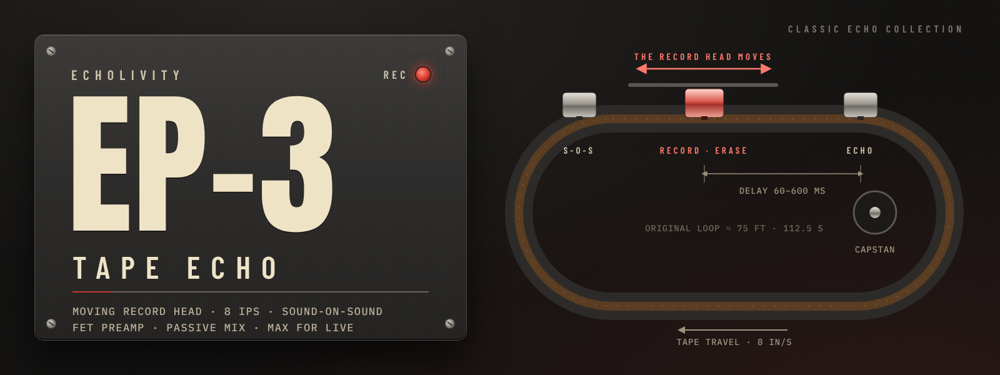
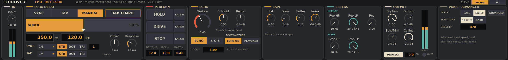
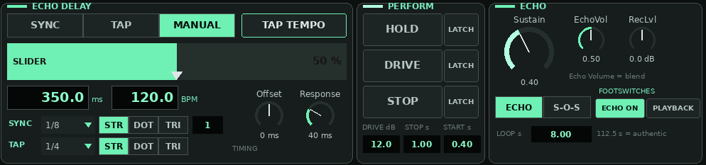

<div align="center">



**WRITE THE PITCH. LOOP THE TAPE. SEND IT ROUND AGAIN.**

*A Max for Live tape echo modelled on the Maestro Echoplex EP-3, the solid-state tape echo built from 1970 to 1991, put to work here for dub: throws, feedback rides, sirens and frozen loops.*


</div>

> [!IMPORTANT]
> **Development build, not road-tested yet.** v0.1.3-dev passes 53 automated tests on the device's own code, but it hasn't been opened in Max 9 or Ableton Live 12, and nobody has played it yet. See [Road-tested?](#road-tested). The panel pictures are approximate renders, not screenshots.

## PLUG IN

Two devices, one sound. Pick by where it goes in your session:

| | **INSERT** | **RETURN** |
|---|---|---|
| **Use it** | Straight on a track | On a return, fed by sends |
| **File** | `devices/Echolivity_EP3_v0.1.3-dev.amxd` | `devices/Echolivity_EP3_v0.1.3-dev_Return.amxd` |
| **Echo Volume starts at** | 0.5 (dry and echo blended) | **1.0 (echo only)** |
| **Why** | The original's blend pot, as on the unit | No second copy of the dry signal in your mix |

Drag the `.amxd` onto the track. Presets and mappings move freely between the two.

<details>
<summary>Live won't take the .amxd?</summary>

1. Add an empty **Max Audio Effect**, click **Edit**, and delete its `plugin~` / `plugout~`.
2. In Max, open the matching `.maxpat` from `devices/`, unlock it, select all and copy.
3. Paste into the empty device and save it as an `.amxd`.

</details>

## THE MOVING HEAD

**The EP-3 moves its record head** along a rail, while the echo head stays put. (The [H&H](https://github.com/Echolivity/echolivity-hh) does the reverse: a fixed record head and a sliding replay head.) So when you slide the delay, the pitch change is **written onto the tape** and comes round again on every repeat. Throw the slider while it's feeding back and the dive is recorded into the loop.

What the device keeps from the unit:
- **Head order along the tape:** S-O-S, then record/erase, then echo. The tape cells the record head crosses are written, so pitch bends are recorded, not just replayed.
- **The FET preamp,** always in the path, with its pre-emphasis: VOICE LATE / EARLY.
- **The passive output mixer:** Echo Volume blends dry and echo on one pot, as on the unit.
- **The playback de-emphasis:** ECHO TONE BRIGHT / DARK.
- **The high-impedance output,** with a Cable pF control for the cable it drives.

## THE LOOP

The EP-3 runs a cartridge loop of about 75 ft, roughly two minutes at 8 ips. The device defaults to an **8 s** loop and goes up to the original **112.5 s**.

- **S-O-S (Sound-on-Sound):** the loop is re-recorded each pass, so you can layer takes. Older layers fade by about 1 dB per pass (adjustable).
- **PLAYBACK footswitch:** stops recording and erasing, so whatever is on the loop keeps replaying while you play over it.
- **ECHO ON footswitch:** echo in or out.

## FOOT CONTROLS

Select the device on Push or a controller, and the first bank is the dub board:

| 1 | 2 | 3 | 4 | 5 | 6 | 7 | 8 |
|:--:|:--:|:--:|:--:|:--:|:--:|:--:|:--:|
| **SUSTAIN** | **ECHO VOL** | **DELAY** | **REPEAT LP** | **REPEAT HP** | **HOLD** | **DRIVE** | **STOP** |

- **HOLD** freezes the loop. **DRIVE** hits the record amp 12 dB harder. **STOP** winds the tape down and back up.
- In the bank they latch. Momentary versions are there for pads and footswitches.
- Put **ECHO TONE** on a spare pad: you'll want it for freezes (see the tip under Dub moves).

## DUB MOVES

Rendered from the device's engine at 75 BPM. Press a link to hear it. It shows what to expect, not proof from Live.

| Move | Do this | You get | Hear it |
|---|---|---|:--:|
| **Throw** | Return, SYNC 1/8 dotted, Sustain 0.6, send one chop | A long, even tail: ~2 dB per repeat, 11 repeats | [▶](listening/D1_throw_return_dot8.wav) |
| **Ride it** | Sustain up to ~0.95 **while the repeats are still going**, then back | It takes off in under a second and settles around −24 dBFS, no clipping; back down in ~4 s | [▶](listening/D2_ride_into_oscillation_dot8.wav) [▶ slap](listening/D2_ride_into_oscillation_slap114ms.wav) |
| **Siren** | While it rings, throw the SLIDER | Pitch dives written to tape | [▶](listening/D3_siren_slider_dive.wav) |
| **Loop filter** | Sustain 0.75, sweep Repeat LP down / Repeat HP up, add Resonance | The repeats darken or thin out and the resonance sings | [▶](listening/D4_loop_filter_sweep_res06.wav) |
| **Freeze** | HOLD for a few bars, release | The loop holds, then decays normally | [▶ BRIGHT](listening/D5_hold_freeze_BRIGHT.wav) [▶ DARK](listening/D5_hold_freeze_DARK.wav) |
| **Drive hit** | DRIVE on one snare | That repeat comes back ~13 dB hotter and saturated | [▶](listening/D7_drive_throw.wav) |
| **Tape stop** | STOP at the end of a phrase | Winds down and up, no click | [▶](listening/D6_tape_stop_insert.wav) |
| **Layer** | S-O-S, play two parts | They stack on the loop | [▶](listening/D8_sos_layering_8s.wav) |

> [!TIP]
> **Freeze melodies in BRIGHT.** In DARK, HOLD keeps only the bass, and a held melodica fades to hiss within two bars. And ride the feedback while there's still something to feed back: from a dead tail at long delays it builds slowly from tape hiss.

## THE FRONT PANEL



<sub>Approximate render from the patch file. The panel is 1,410 px wide in Live.</sub>

| | |
|---|---|
| **ECHO DELAY** | SYNC / TAP / MANUAL. The **SLIDER** is the record head (60–600 ms by default). Sync and tap divisions with straight, dotted or triplet; multiplier; offset; slider response |
| **PERFORM** | HOLD · DRIVE · STOP pads, each with a LATCH; drive amount, stop and start times |
| **ECHO** | Sustain, Echo Volume, Record Level, ECHO / S-O-S, footswitches, loop length |
| **TAPE** | Saturation, wow, flutter, tape noise |
| **FILTERS** | Repeat HP / LP / Resonance inside the loop; Echo HP / LP on the way out |
| **OUTPUT** | Dry and echo trims, output, PROTECT with ceiling, GR and OVER |
| **VOICE · ADVANCED** | LATE / EARLY, BRIGHT / DARK, Cable pF. **ADVANCED** opens head speed, hold feedback, bias, SOS loss and slider range |

Every one of the 53 performance and engine controls can be automated, MIDI-mapped and saved with the set ([full list](docs/PARAMETERS.md)). Two looks, switched top right: **EMBER** (warm amber, default) and **EL** (black with green legends).



## ROAD-TESTED?

Not yet. Here's exactly where it stands:

| | Built | Tested offline | Max 9 | Live 12 | By ear |
|---|:--:|:--:|:--:|:--:|:--:|
| Moving record head, loop, S-O-S, PLAYBACK | ● | ● | ○ | ○ | ○ |
| Feedback, self-oscillation, output protection | ● | ● | ○ | ○ | ○ |
| HOLD, BRIGHT / DARK | ● | ● | ○ | ○ | ○ |
| Click-free switching | ● | ● | ○ | ○ | ○ |
| Insert / Return, dub bank, themes | ● | ● structure | — | ○ | — |
| 30-minute automated run | ● | ● | — | ○ | — |

● done · ○ to do · — not applicable. "Offline" means the device's GenExpr code compiled to C. It proves the algorithm, not the device in Live. **Results:** 7/7 · 19/19 · 5/5 · 8/8 · 14/14 (regression against v0.1.0 at 44.1 / 48 / 96 kHz), all re-run from the packaged archive.

**Got Max 9 and 20 minutes?** Open [`tests/golden/EP3_host_harness.maxpat`](tests/golden/), press each RUN, then double-click `RUN_HOST_CHECKS.bat` (or run `python3 tests/golden/run_host_checks.py`). Send the report and your Max Console text. Full session: [owner testing guide](reports_v0.1.3/EP3_OWNER_TESTING_GUIDE.md).

## KNOWN QUIRKS

- **HOLD in DARK keeps only the bass.** A trial fix with A/B audio is in [`experimental/hold_dark_loop/`](experimental/hold_dark_loop/).
- **The engine is mono, like the unit.** On a stereo insert the dry goes mono too; use the Return version to keep it stereo.
- **The panel is wide** at 1,410 px.
- All issues: [known-issues register](reports_v0.1.3/EP3_KNOWN_ISSUES.md).

<details>
<summary><b>UNDER THE LID</b>: files, sources, building</summary>

| | |
|---|---|
| `devices/` | Insert and Return devices (`.amxd` and editable `.maxpat`), 55 parameters |
| `dsp/ep3_core.genexpr` | The whole engine: one gen~ codebox |
| `docs/` | [Modelling notes](docs/EP3_MODELING_NOTES.md) (every value sourced or marked APPROX), [sources](docs/SOURCES.md), [parameters](docs/PARAMETERS.md), [Max/Live test plan](docs/TEST_PLAN_Max_Live.md) |
| `tests/` | Engine, UI, workflow and regression suites; Max 9 harness; dub scenarios; name lint |
| `listening/` | Every dub-move render and the HOLD study |
| `baseline/`, `experimental/` | Frozen v0.1.0 for regression; candidates not in any device |
| `reports_v0.1.3/`, `validation/`, `remediation/` | Release decision, test reports and history |
| `docs/images/src/` | HTML sources of the banner |

```sh
python3 build/build_device.py && EP3_VARIANT=return python3 build/build_device.py
for t in test_derived test_ep3 test_ui_theme test_workflow test_remediation; do python3 tests/$t.py; done
```
Python 3 with numpy and scipy, plus gcc. Changes: [CHANGELOG](CHANGELOG.md).

The look is Echolivity's own: no Maestro or Echoplex logos, artwork or panel graphics. *Maestro and Echoplex are trademarks of their respective owners; this project is not affiliated with them.*

</details>

<div align="center">
<sub><b>ECHOLIVITY</b> · Classic Echo Collection · also: <a href="https://github.com/Echolivity/echolivity-hh">H&amp;H Echo Unit</a> · <a href="https://github.com/Echolivity/echolivity-dub-siren">Dub Siren</a> · <a href="https://github.com/Echolivity/fisher-spring">Fisher Spring</a></sub>
</div>
